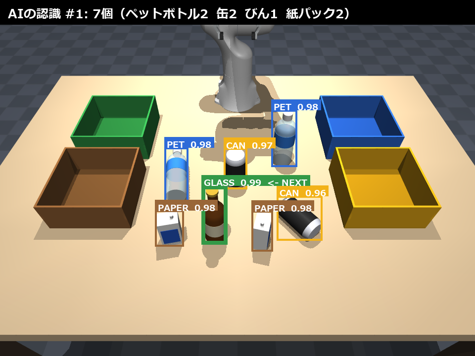

# AI × ロボットによる資源ごみ分別（Physical AI 応用編1 最終課題）

固定カメラの画像を **Gemini Robotics-ER 2**（Google の身体性推論 VLM）が見て、机の上の資源ごみの
品目と分別区分（ペットボトル／缶／びん／紙パック）を判定し、**Franka Panda** アームが 1 個ずつ
つかんで色分けされた回収箱へ入れるデモです。シミュレータは **MuJoCo** です。



## しくみ

```
固定 RGB-D カメラ ──RGB──▶ Gemini Robotics-ER 2 ──▶ 物体ごとの枠・品目名・分別区分（JSON）
        │                                                        │
        └──Depth──▶ 枠内の点群 ──▶ 上面の重心で 3D 位置、主軸で向き、最高点で高さ、倒れ判定
                                                                 │
                    背の高い物から 1 個選ぶ ◀──────────────────────┘
                                 │
           逆運動学（減衰最小二乗）で把持 → 回収箱へ運搬 → カメラの視界をあける → 再観察
```

- **閉ループ**: 1 個つかむごとに撮り直して AI に再認識させ、机が空になるまで繰り返します。
  取り損ねた物や倒れた物も次の観察で拾い直します（同じ場所で 2 回失敗したら諦めます）。
- **AI の出力だけで動く**: 位置・向き・高さ・倒れているかはすべてカメラ画像から推定します。
  シミュレータの正解値は評価（ログ）にだけ使い、制御には使っていません。
- **把持の工夫**: 指はカメラの奥行き方向に閉じる（推定誤差が最も大きい方向を、閉じる動作で
  自己補正する）、背の高い物から取る（ハンドが隣の物に当たらない順序）、倒れた物は胴をまたいで
  つかむ、など。

## 動かし方

Python 3.11 以上（開発は 3.13 / Windows 11、GPU 不要）。

```bash
python -m venv .venv
.venv/Scripts/activate        # Linux/macOS: source .venv/bin/activate
pip install -r requirements.txt

# Gemini API キー（Google AI Studio で発行。無料枠で動作）
echo GEMINI_API_KEY=xxxxxxxx > .env

python run_demo.py --seed 0                  # output/run_seed0/demo.mp4 と log.json を生成
python run_demo.py --seed 0 --offline        # キャッシュ済みの AI 応答だけで再生成（API 不要）
python run_demo.py --seed 0 --simple         # 倒れた物なしの 6 個で実行

python scripts/batch_eval.py --seeds 0 10              # 評価モードで成功率を測る（API・動画なし）
python scripts/batch_eval.py --seeds 0 10 --demo-mix   # 倒れた物を含む 7 個の配置で測る
```

`output/gemini_cache/` に AI の応答を画像ハッシュごとに保存するので、同じシードの再実行では
API を呼びません。物理演算は決定的なので、字幕などを直しただけなら `--offline` で同じ動画を
作り直せます。

評価モードでは、AI の代わりに「正解の物体をカメラ画像に投影した枠」を渡します。
枠から先（深度による 3D 推定・把持・運搬）は本番とまったく同じ処理です。

## 結果

| 条件 | 結果 |
|---|---|
| 本番（Gemini Robotics-ER 2、7 個・うち 2 個は倒れた状態、seed 0） | 7/7 正しい箱へ、AI 呼び出し 8 回、品目判定 28/28、倒れ判定 13/13、位置誤差 平均 1.8 mm（立った物）・8.2 mm（倒れた物を含む全 7 個） |
| 評価モード・標準配置（立った 6 個 × 10 通り） | 60/60 |
| 評価モード・デモ配置（7 個 × 10 通り） | 70/70（倒れた物の把持 21 回、取り損ね 1 回は再観察で回収） |

## ファイル構成

| パス | 内容 |
|---|---|
| `run_demo.py` | 観察 → 認識 → 把持 → 分別のループと動画生成 |
| `recycle_sort/scene.py` | MjSpec でシーン（机・回収箱・品目）を構築 |
| `recycle_sort/vision.py` | Gemini Robotics-ER 呼び出し、深度からの 3D 推定、注釈描画 |
| `recycle_sort/robot.py` | 逆運動学と滑らかな動作プリミティブ |
| `recycle_sort/tasks.py` | 把持・運搬・投入の手順 |
| `recycle_sort/hud.py` / `recorder.py` | 字幕・小窓・タイトルカードと MP4 書き出し |
| `recycle_sort/episode.py` | 1 回の分別（観察→認識→把持→再観察）、AI 検出器と評価用の検出器 |
| `recycle_sort/layout.py` | 品目のランダム配置（倒れた状態を含む） |
| `scripts/` | 評価（`batch_eval.py`）と動作確認用（シーンのプレビュー、正解値での分別、認識テスト、API キー確認） |

## ライセンス

このリポジトリのコードは MIT License です（[LICENSE](LICENSE)）。`third_party/` 以下は除きます。

## 第三者の素材

- `third_party/franka_emika_panda/`: [MuJoCo Menagerie](https://github.com/google-deepmind/mujoco_menagerie)
  の Franka Emika Panda モデル（Apache License 2.0、同フォルダの LICENSE を参照）。
  グリッパの把持力のみ、読み込み時にコード側で変更しています。

## 参考にしたもの

- 講座の最終課題サンプル「Pick and Place Task - ROS2 Gazebo Simulation (UR3 + Robotiq 2f-85)」:
  アームによるピック＆プレースの流れ
- 講座の最終課題サンプル「Gemini Robotics-ER 1.6 を試す」: VLM によるゴミ分別の画像注釈。
  本作は認識だけで終わらせず、3D 位置推定と把持・運搬までつないで実行しています。
